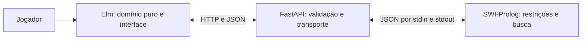

# ✦ Jardim de Luz

**Seis lanternas. Um jardim. Um equilíbrio exato.**

Um quebra-cabeça de posicionamento e energia, construído para o trabalho final de **Paradigmas de Programação**. A busca vive em **Prolog**, a interface e o estado em **Elm**, e o **Python** faz somente a integração.


> **Situação da entrega:** implementação e testes disponíveis; identificação acadêmica, contribuições e avaliação 360 ainda precisam da revisão do grupo. O repositório pessoal não substitui a atividade do GitHub Classroom.

[Como jogar](#como-jogar) · [Executar](#executar) · [Testes](#testes) · [Relatório](RELATORIO.md) · [Guia de estudo](docs/GUIA-DE-ESTUDO.md) · [Checklist de entrega](docs/ENTREGA.md)

## Como jogar

Coloque **seis lanternas** num jardim 6×6. Cada casa tem uma energia de 1 a 9.

1. Cada linha e cada coluna deve ter exatamente uma lanterna.
2. Duas lanternas não podem estar na mesma diagonal, mesmo à distância.
3. A soma das energias das seis casas ocupadas deve ser igual à **energia alvo**.

Clique numa casa para colocar a lanterna. Clique de novo para retirá-la ou em outra casa da mesma linha para movê-la. As pistas **◆** são fixas; suas energias também entram na soma. Você pode usar Tab e Enter/Espaço para jogar pelo teclado.

| Símbolo | Significado |
|:---:|---|
| ✦ | Lanterna colocada por você |
| ◆ | Pista inicial, protegida contra alterações |
| ✧ | Lanterna revelada pelo Prolog |
| Borda tracejada e aviso | Conflito de coluna ou diagonal |

**Brotar** começa com duas pistas; **Florescer**, com uma; **Iluminar**, sem pistas. Cada novo jardim é gerado pelo Prolog e tem **solução única**, inclusive antes das pistas. Os níveis variam o apoio inicial, sem prometer uma classificação pedagógica de dificuldade.

Desfaça jogadas, reinicie o mesmo jardim, peça uma dica ou revele a solução. Uma dica considera todas as soluções compatíveis e só chama uma posição de **forçada** se ela aparece em todas. Se suas jogadas impedirem uma solução, o sistema avisa; reinicie ou retire uma lanterna para continuar.

## Por que Prolog + Elm?



O Prolog modela a coluna de cada lanterna com CLP(FD), declara colunas distintas, diagonais livres e uma soma de energia com `element/3`. O mesmo predicado serve para encontrar uma solução ou enumerar todas. O gerador escolhe alvos que distinguem uma única configuração.

O Elm separa domínio (`Garden.elm`), HTTP/JSON (`Api.elm`) e aplicação (`Main.elm`). `Starting`, `StartFailed`, `Ready` e `Waiting` representam as fases da interface: não existe uma consulta em andamento sem um jogo para preservar. Pistas, jogadas e revelações também têm construtores diferentes.

## Executar

### Requisitos

- **SWI-Prolog 9.2+**, com `swipl` no PATH;
- **Node.js 24 LTS** e npm — o Vite também aceita Node 20.19+ ou 22.12+;
- **uv** para instalar Python e dependências; backend com Python 3.11+;
- internet na primeira instalação, inclusive para baixar os pacotes Elm.

Verificado neste desenvolvimento em **Windows**, com SWI-Prolog **9.2.9**, Python **3.12.16**, uv **0.13.6**, Node **24.22.1**, Elm **0.19.2** e Vite **8.3.6**. O compilador Elm é instalado localmente pelo npm.

```sh
git clone https://github.com/Devv-Antonio/jardim-de-luz.git
cd jardim-de-luz
uv sync --project backend --locked
cd frontend
npm ci
```

Abra **dois terminais** a partir da raiz do projeto:

```sh
# Terminal 1
cd backend
uv run uvicorn app.main:app --reload --host 127.0.0.1 --port 8000
```

```sh
# Terminal 2
cd frontend
npm run dev
```

Acesse **http://localhost:5173**. A API interativa está em **http://localhost:8000/docs**. Se o repositório estiver privado, faça o login no GitHub antes de clonar.

Com GNU Make instalado, os atalhos equivalentes são `make install` e `make dev`. Nenhum Make é necessário no Windows.

O Vite encaminha `/api` para `127.0.0.1:8000`, inclusive no preview. O backend chama um processo `swipl` por pedido, sem Janus, compilador C ou configuração de DLL. Os argumentos do processo são fixos; os dados passam como JSON por stdin, sem interpolação de código Prolog nem shell.

**Ao alterar Elm durante o desenvolvimento**, execute `npm run compile` em outro terminal e recarregue o navegador. CSS e JavaScript continuam com recarga do Vite. A compilação explícita evita o problema do plugin Elm do template em caminhos Windows com espaços e acentos.

### Build de produção local

```sh
cd frontend
npm run build
npm run preview -- --port 5173
```

Mantenha o backend em execução. O build gera `frontend/dist/`, com Elm otimizado e fontes locais; ele não torna o backend desnecessário. Uma hospedagem apenas estática, como GitHub Pages, não executa o Prolog.

## Testes

Na raiz:

```sh
swipl -q -g run_tests -t halt backend/prolog/test_garden.pl
```

```sh
cd backend
uv run pytest -q
```

```sh
cd frontend
npm test
npm run format:check
npm run build
npm audit
```

Ou `make test` e `make build`. A integração contínua em `.github/workflows/ci.yml` repete instalação, testes e build em Ubuntu a cada push/PR. Consulte o resultado da execução no GitHub; a existência do workflow não é evidência de uma execução bem-sucedida.

| Camada | Verificações locais |
|---|---|
| Prolog | 17 testes plunit; quatro soluções de N-rainhas; energia; conflitos; pistas; dicas; geração de 60 jardins nos três níveis |
| API | 30 casos pytest com Prolog real, incluindo JSON inválido, campos extras, tipos estritos e respostas 422 |
| Elm | 17 verificações do domínio e dos decoders, compiladas pelo Elm e executadas no Node, sem framework adicional |
| Qualidade | Elm formatado, build otimizado e auditoria npm sem vulnerabilidades na verificação local |

O roteiro de teste no navegador está em [docs/TESTE-MANUAL.md](docs/TESTE-MANUAL.md). Evidências e limites são detalhados no relatório.

## API

Um tabuleiro é uma lista de **seis colunas**, uma por linha: `0` significa vazio e `1..6` representa a coluna da lanterna. Não é uma matriz de booleanos.

| Rota | Entrada | Saída |
|---|---|---|
| `POST /api/generate` | `{"difficulty":"medium"}` | `energies` (6×6), `target`, `givens` (6 colunas) |
| `POST /api/solve` | Puzzle + `board` | `{"board":[2,4,6,1,3,5]}` |
| `POST /api/hint` | Puzzle + `board` | `{"row":0,"column":2,"forced":true}` |

`row` começa em zero; `column` vai de 1 a 6. Erros de formato, jogos impossíveis e dicas em jogos completos retornam **422**. O jogador não consegue sobrescrever pistas: o servidor aplica `givens` independentemente de `board`. As rotas de solução e dica respeitam as jogadas atuais.

## Mapa do projeto

```text
backend/
  prolog/garden.pl          regras, geração e dicas
  prolog/bridge.pl          protocolo JSON do processo Prolog
  prolog/test_garden.pl     testes plunit
  app/main.py              contrato HTTP e validação
  app/prolog.py            transporte de dados para swipl
  tests/test_api.py         testes da integração real
frontend/
  src/Garden.elm           domínio puro e tabuleiro imutável
  src/Api.elm              comandos HTTP e decoders validados
  src/Main.elm             fases, mensagens, update e view
  src/style.css            interface responsiva e foco visível
  tests/Checks.elm         verificações puras
  tests/run.cjs            execução das verificações no Node
docs/                     evidências, regras, estudo e entrega
RELATORIO.md              relatório nas 13 seções do professor
AVALIACAO.md              rubrica original, preservada
avaliacao-360/TEMPLATE.md modelo individual original, preservado
scripts/                  ferramentas originais do professor
```

## Entrega e autoria

A faixa proposta é **remix original**: posicionamento de N-rainhas combinado à seleção de casas por energia e um alvo de soma exata. A confirmação da faixa cabe ao professor. Não reivindicamos exclusividade mundial para essa combinação.

Este projeto foi desenvolvido com **uso intensivo de IA (Codex)**. O template e as regras de avaliação vêm de [fabiommendes/paradigmas-trabalho-final](https://github.com/fabiommendes/paradigmas-trabalho-final), revisão `8454eea9bd08b9ef5e3b0538532d18a23174a93c`. A origem, os arquivos reaproveitados e o que foi reescrito estão declarados na seção 11 do relatório e em [docs/ORIGEM.md](docs/ORIGEM.md). A arquitetura foi adaptada; o domínio Sudoku foi substituído.

**Antes da entrega:** preencher os dados acadêmicos reais, revisar contribuições, estudar o código, ensaiar os 15 minutos, publicar no Classroom e cada aluno entregar sua própria avaliação 360. Execute `uv run scripts/validar_entrega.py` e corrija todos os erros. O relatório conserva campos pendentes intencionais enquanto faltam os dados do grupo; não os substitua por informações fictícias.

Prazo sem desconto: **18/11/2026, 23h59 de Brasília**. Os lotes de 23/11 e 30/11 têm fatores 0,90 e 0,75 em G. Avaliação 360 até **30/11/2026, 23h59**. Consulte [AVALIACAO.md](AVALIACAO.md) para todas as regras.

## Limites assumidos

O jardim é sempre 6×6 e tem apenas quatro padrões geométricos possíveis antes da regra de energia. Não há conta, cronômetro, armazenamento ou placar; ao recarregar, um novo jardim é gerado. A dificuldade varia pelas pistas. Há custo de iniciar o Prolog a cada pedido, adequado a este trabalho local. Uma implantação pública exigiria planejamento de concorrência e limites de requisições.

### Saída Unicode no PowerShell

Se o validador original falhar ao imprimir ✓ ou ✘ por causa da codificação do terminal, execute primeiro:

```powershell
$env:PYTHONUTF8 = "1"
uv run scripts/validar_entrega.py
```

O script do professor foi preservado; isso só configura a codificação do processo Python.
